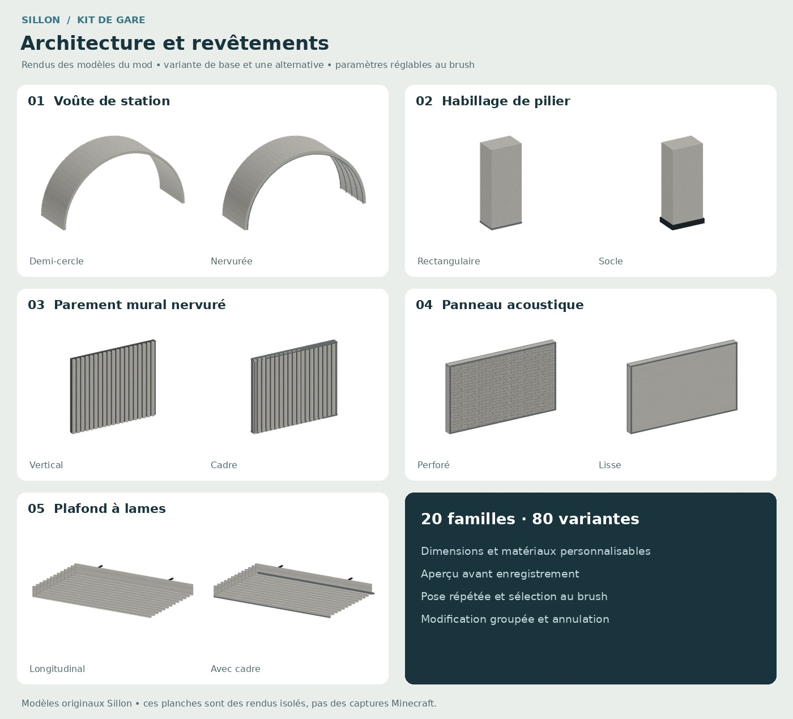
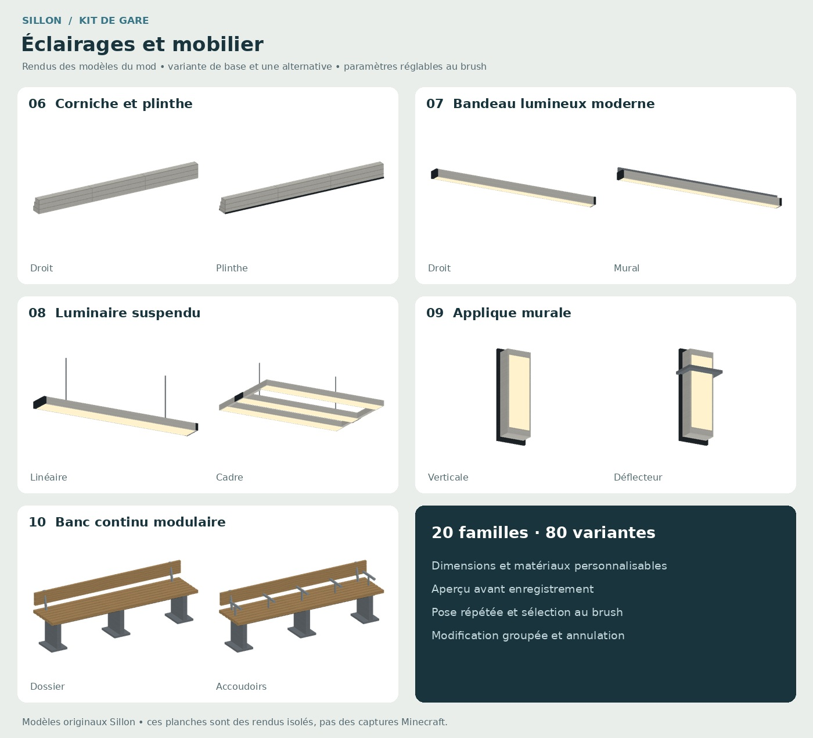
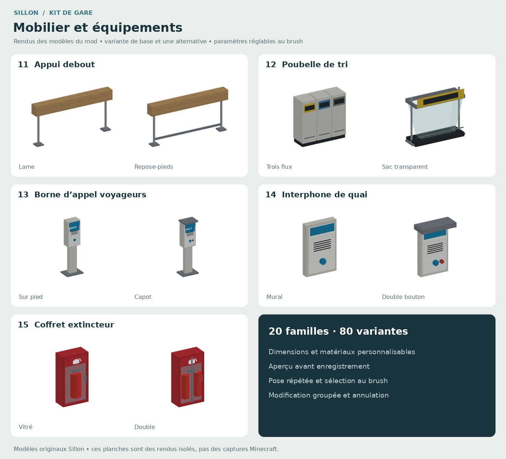
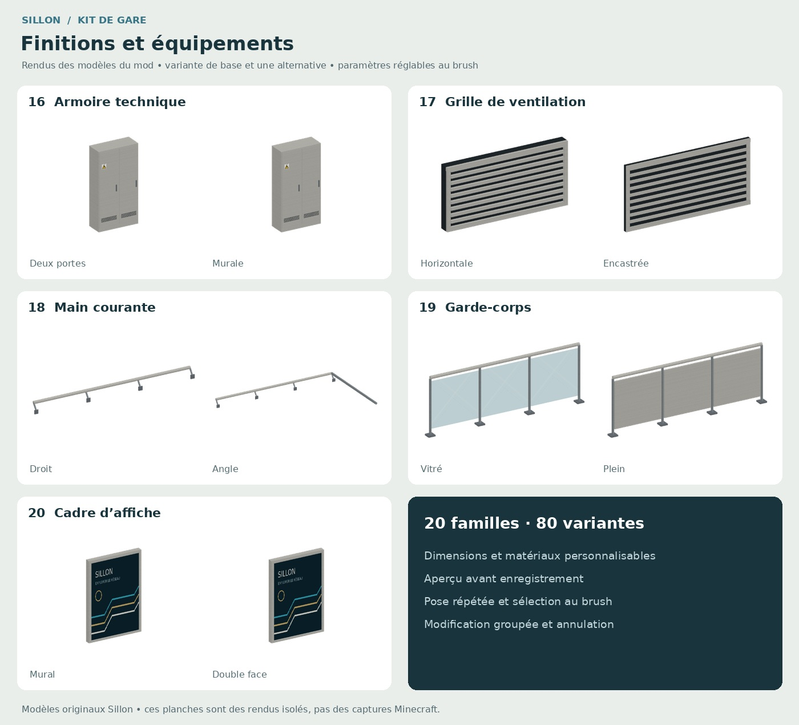
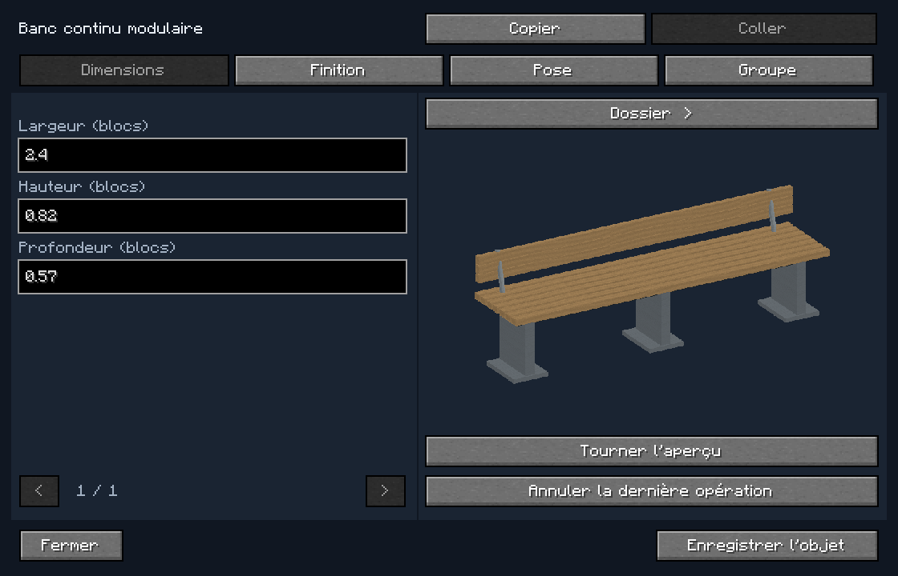

# Sillon — les 20 éléments du kit de gare

Ces quatre planches montrent les **meshes de production du mod**, rendus avec leurs textures. Ce sont des rendus logiciels, pas des captures Minecraft ni des images de concept. Les modèles sont originaux, inspirés du mobilier ferroviaire documenté dans le [guide et ses références](README.md).

Chaque famille possède quatre variantes : **20 objets, 80 variantes**. Dimensions, matières, couleurs et pose se règlent au brush. L'éditeur permet la modification groupée, la répétition avec prévisualisation et l'annulation.

## Éditeur dans Minecraft

Cette image est une **capture réelle du client Minecraft**, produite par le test natif.

[Captures de tous les objets et de l'éditeur, avec et sans shaders](../signage/review/native/)

## Téléchargements

- [Planches, fiches, variantes PNG et modèles OBJ — ZIP](gallery/Sillon-Kit-Gare-Toutes-les-Images.zip)
- [Build Forge 1.20.1 de cette révision](https://github.com/1GNTV/Minecraft-Transit-Railway/actions/runs/39402798335/artifacts/12256261932)
- [Validation du build et tests natifs](https://github.com/1GNTV/Minecraft-Transit-Railway/actions/runs/39402798335)

Le mobilier est décoratif : pas de collision étendue, de fonction pour s'asseoir ou d'appel simulé. Les dimensions sont adaptées à Minecraft ; ces objets ne sont pas des répliques certifiées d'une gare particulière. Voir le [guide](README.md) pour les commandes, bornes des opérations et limites.
