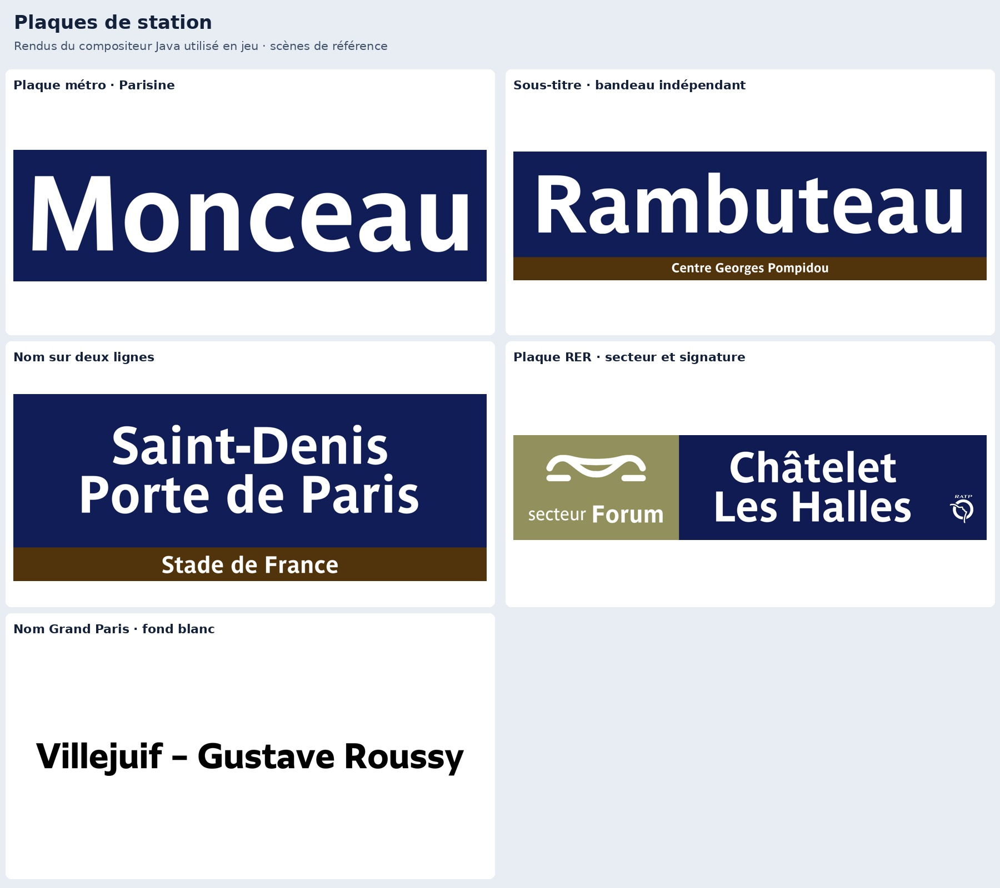
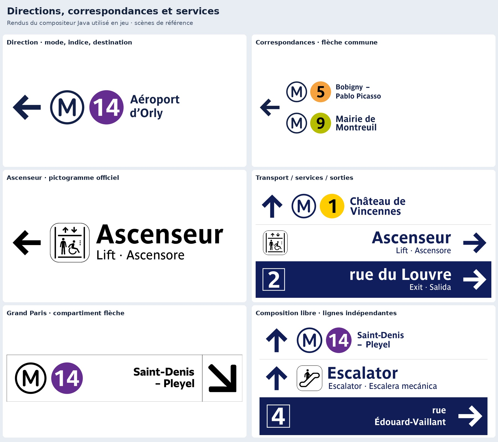
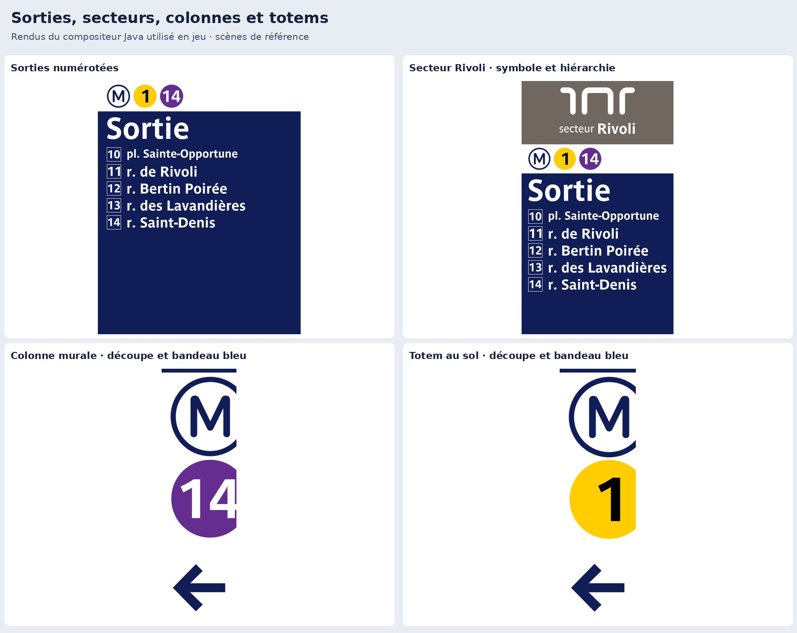
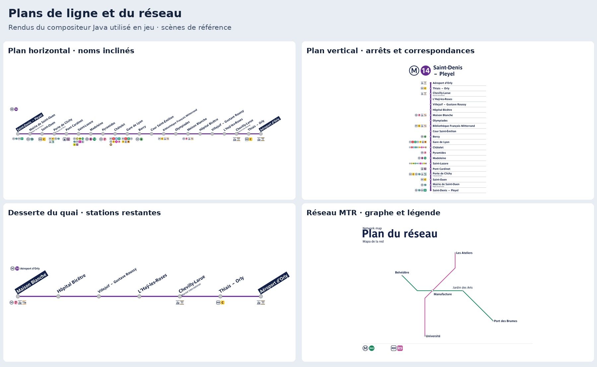
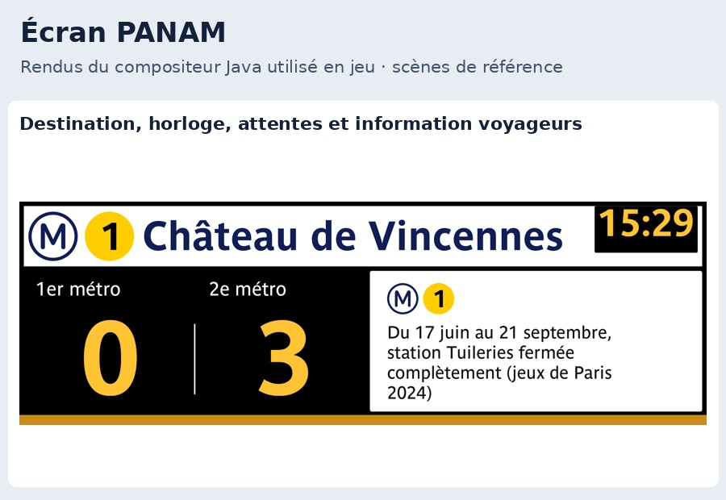
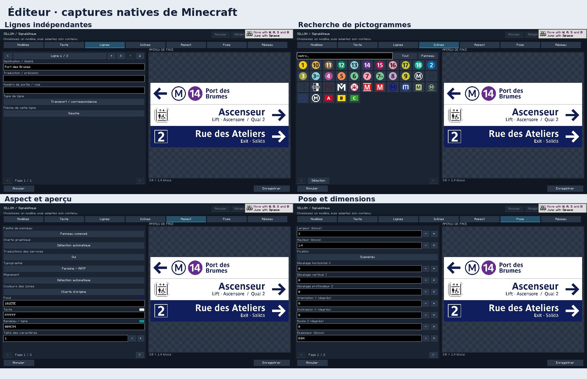

# Galerie de tous les correctifs

Les cinq premières planches montrent les textures générées par le compositeur Java réellement utilisé en jeu. La sixième montre l’éditeur natif. Cliquez sur les images pour les ouvrir en pleine taille.

## Plaques métro, sous-titres, noms sur deux lignes, RER et Grand Paris

## Directions, correspondances, services et compositions

## Sorties, secteurs, colonnes et totems

## Plans horizontaux, verticaux, dessertes et réseau

## Écran PANAM

## Éditeur : vraies captures dans Minecraft

## Chaque scène en pleine définition

- [plaque monceau](../review/reference-review/01-plaque-monceau.png)
- [plaque rambuteau](../review/reference-review/02-plaque-rambuteau.png)
- [plaque deux lignes](../review/reference-review/03-plaque-deux-lignes.png)
- [rer forum](../review/reference-review/04-rer-forum.png)
- [direction](../review/reference-review/05-direction.png)
- [correspondances](../review/reference-review/06-correspondances.png)
- [sorties](../review/reference-review/07-sorties.png)
- [secteur rivoli](../review/reference-review/08-secteur-rivoli.png)
- [colonne metro](../review/reference-review/09-colonne-metro.png)
- [totem metro](../review/reference-review/10-totem-metro.png)
- [ascenseur](../review/reference-review/11-ascenseur.png)
- [panneau compose](../review/reference-review/12-panneau-compose.png)
- [panam](../review/reference-review/13-panam.png)
- [nom grand paris](../review/reference-review/14-nom-grand-paris.png)
- [direction grand paris](../review/reference-review/15-direction-grand-paris.png)
- [plan horizontal](../review/reference-review/16-plan-horizontal.png)
- [plan vertical](../review/reference-review/17-plan-vertical.png)
- [desserte quai](../review/reference-review/18-desserte-quai.png)
- [composition libre](../review/reference-review/19-composition-libre.png)
- [reseau automatique](../review/reference-review/20-reseau-automatique.png)
